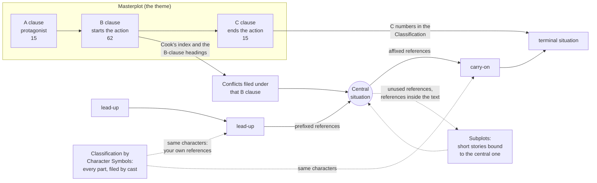

# Plotto: a map of the system

> The site's data (`docs/plotto-data.js`) was built from Project Gutenberg's text of *Plotto* and a
> scan of the whole book, by a parser. Those sources, the parser and the local development server
> mentioned below are not part of this repository.

*Plotto: A New Method of Plot Suggestion for Writers of Creative Fiction*, William Wallace Cook, 1928.

There are two sources:

- `plotto-mf.html`: a clean digital edition of the chart, the conflicts and the character symbols. **A** is the male protagonist and **B** the female.
- `Plotto.rtfd`, converted to `plotto-full.txt`: a scan of the whole book. It adds two parts the HTML lacks:
  - the **Classification by Character Symbols** (pp. 266–438);
  - Cook's seven-lesson **Instruction Manual** (from p. 439).

## 1. The one law

> Purpose, expressed or implied, opposing Obstacle, expressed or implied, yields Conflict.

Cook reduces every purpose to one, *to achieve happiness*, pursued in three spheres. The book's three
groups of conflicts follow those spheres: **Love and Courtship**, **Married Life**, and **Enterprise**.

## 2. The building blocks



**The Masterplot** is one sentence in three interchangeable clauses. Any A works with any B and any C,
so the chart holds 15 × 62 × 15 = 13,950 masterplots. Cook's own example:

> **A** (11) A Person Swayed by Pretense, **B** (49) assuming a fictitious character when embarking upon a
> certain enterprise, **C** (2) emerges happily from a serious entanglement.

**The Conflicts** are the concrete situations: 1,462 numbered conflicts, 1,852 lettered entries
(1a, 1b, …). They are grouped by sphere and sub-group, and filed under 163 B-clause headings. The B
clause therefore decides which shelf of conflicts the central situation comes from. Clause (62), "any
sort of complication", opens all of them.

**The Classification by Character Symbols** files every conflict again, by cast ("A", "A & A-3",
"A, B & X" …) and then by sub-group. Broken conflicts are filed as separate fragments. Fragments that
can end a story carry the number of the C clause they realize. It has two uses: finding endings, and
finding your own lead-ups and carry-ons by cast.

| Group | Sub-group | Conflicts | Count | Entries |
|---|---|---|---:|---:|
| Love and Courtship | Love's Beginning | 1–39 | 39 | 84 |
| Love and Courtship | Love's Misadventures | 40–181 | 142 | 182 |
| Love and Courtship | Marriage Proposal | 182–204 | 23 | 27 |
| Love and Courtship | Love's Rejection | 205–341 | 137 | 169 |
| Love and Courtship | Marriage | 342–368 | 27 | 45 |
| Married Life | – | 369–594 | 226 | 290 |
| Enterprise | Misfortune | 595–746 | 152 | 175 |
| Enterprise | Mistaken Judgment | 747–803 | 57 | 66 |
| Enterprise | Helpfulness | 804–850 | 47 | 58 |
| Enterprise | Deliverance | 851–896 | 46 | 57 |
| Enterprise | Idealism | 897–978 | 82 | 96 |
| Enterprise | Obligation | 979–1022 | 44 | 51 |
| Enterprise | Necessity | 1023–1033 | 11 | 11 |
| Enterprise | Chance | 1034–1056 | 23 | 26 |
| Enterprise | Personal Limitations | 1057–1140 | 84 | 96 |
| Enterprise | Simulation | 1141–1208 | 68 | 77 |
| Enterprise | Craftiness | 1209–1289 | 81 | 113 |
| Enterprise | Transgression | 1290–1309 | 20 | 26 |
| Enterprise | Revenge | 1310–1329 | 20 | 25 |
| Enterprise | Mystery | 1330–1446 | 117 | 155 |
| Enterprise | Revelation | 1447–1462 | 16 | 23 |

## 3. Anatomy of a conflict

```
1173                                                ← number (lettered a, b, c… when it has several entries)
   2b, c, d, e, g, h     1187 ; 2f                  ← LEAD-UPS, prefixed: what can come before
   A, a pretender, encounters B, who is also a pretender  *
   A and B are pretenders, yet neither knows that the other is not what he or she seems to be  **
                                                    ← the situation, in break-parts marked * ** ***
   773 ; 772 ch A to B & A-4 to A     806 ch B-4 to B     1462
                                                    ← CARRY-ONS, affixed: what can come after
```

Each entry is a small graph node. Its prefixed references point backward in story time and its affixed
references point forward. The whole book is one large web of 11,043 references.

## 4. Cook's reference notation

| Notation | Meaning | Count |
|---|---|---:|
| `112` | conflict 112 (any of its entries) | |
| `2b, c, d` | entries b, c and d of conflict 2 | |
| `163 ; 91` | a **combination**: use 163, then 91 | 425 groups |
| `1177 or 1178` | alternatives within a combination | 3 |
| `1a -*` | only the part before the first star | |
| `364d *-**` | only the part between the first and second stars | 1,039 entries have parts |
| `259-1` | option [1] of a conflict that offers numbered options | 28 entries have options |
| `ch A to B & A-4 to A` | **change** symbols: the linked conflict's A becomes B, its A-4 becomes A | 1,725 references |
| `tr A & A-3` | **transpose**: A and A-3 swap places | (in the 1,725) |
| `add B` | bring character B into the situation | |
| `ch “wife” to “sweetheart”` | change a phrase in the text | |
| `eliminate “prison cell”` | drop a phrase | |
| a number inside the text | usually an explanatory suggestion for one phrase or option (Manual, Lesson 4) | 428 |

Changes exist because every auxiliary conflict must be "changed, or transposed … to agree with the
character symbols of the Conflict whose ramifications are being studied". A suggestion written about
A can be borrowed for B, for a rival, or for a father.

## 5. Character symbols

| Symbol | Character |
|---|---|
| A, B | the male and female protagonists |
| A-2 / B-2 | friend |
| A-3 / B-3 | rival or enemy |
| A-4 / B-4 | stranger |
| A-5 / B-5 | criminal |
| A-6 / B-6 | officer of the law |
| A-7 / B-7 | inferior, employee |
| A-8 / B-8 | utility symbol (any further character) |
| A-9 / B-9 | superior, employer, one in authority |
| F-, M-, BR-, SR-, SN-, D-, U-, AU-, CN-, NW-, NC-, GF-, GM-, SF-, SM-, GCH- + A or B | father, mother, brother, sister, son, daughter, uncle, aunt, cousin, nephew, niece, grandfather, grandmother, stepfather, stepmother, grandchild of A or B |
| CH | a child |
| AX, BX | a mysterious man or woman; X added to any symbol makes the character mysterious |
| X | an object, an object of mystery, an uncertain quantity |

## 6. The three ways to build a plot

**From a Masterplot** (the book's first worked example)
1. Choose an A, a B and a C clause.
2. Go to the conflicts filed under the B clause and choose the **central situation**.
3. Choose a lead-up from its prefixed references, and repeat backward as far as needed.
4. Choose carry-ons from the affixed references until the action terminates in the spirit of the C clause.
5. Apply the changes, transpositions and break-parts; drop or reorder conflicts freely.

**From a selected situation** (the second worked example) starts at step 2 with any conflict. The theme
then appears as the plot grows.

**With your own references** (Instruction Manual, Lesson 5). Cook's printed references are "merely the
author's suggestions", and it is "your duty as well as your pleasure" to find your own. The method:
1. Take the character symbols of the situation you are studying.
2. Look up that combination in the Classification by Character Symbols.
3. If the combination is long, or offers too few conflicts, "drop one of the lesser symbols". Repeat
   until only A, B, or A and B remain. Those groups "will yield suggestions for any of the Conflicts".

## 7. Compound masterplots

The Instruction Manual (Lesson 1) adds **compound masterplots**: more than one clause in a column,
"for the advanced plottoist" only. Cook's examples:

- A: "(1) A Person in Love, (7) A Person of Ideals"
- B: "(1) engaging in a difficult enterprise …, and (43) seeking to overcome personal limitations …"
- C: "(7) reverses certain opinions …, and (9) achieves success and happiness …"

## 8. Story forms

| Form | Cook's description | Shape |
|---|---|---|
| Short story | one dramatic situation: the main conflict, the one leading up to it, and the one terminating it (two if the main conflict is itself terminal) | lead-up → central → terminal |
| Novelette | a long short story, or a short novel whose paramount purpose involves subordinate purposes | a longer main line + one subplot |
| Novel | several short stories all leading up to, and bound up with, the paramount purpose; the subordinate situations grow toward one crisis | main line + several subplots |

## 9. Termination and the C clause

In the Classification, "possible terminal situations are indicated by the numbers of the C Clauses".
For example, "(9) A marries B — 364c", or "(1) A, overwhelmed by misfortune in love, commits suicide —
281b". Some fragments carry several clauses, "(1-5)" meaning clauses 1 and 5. Clause (15), "meets any
fate", carries none, since any ending fits it.

Cook's NOTE: if no fragment with the desired number is found in the sub-group, "other subgroups should
be scanned for a Conflict approximating the one desired, and the situation altered to correspond with
the needs of the moment". Another, nearly synonymous C clause may also be substituted.

| C clause | Marked parts |
|---|---:|
| (1) Pays a grim penalty in an unfortunate undertaking | 447 |
| (2) Emerges happily from a serious entanglement | 85 |
| (3) Foils a guilty plotter and defeats a subtle plot | 43 |
| (4) Undertakes a role that leads straight to catastrophe | 348 |
| (5) Emerges from a trying ordeal with sorely garnered wisdom | 50 |
| (6) Makes the supreme sacrifice in carrying out an undertaking | 31 |
| (7) Reverses certain opinions when their fallacy is revealed | 35 |
| (8) Achieves a spiritual victory | 82 |
| (9) Achieves success and happiness in a hard undertaking | 118 |
| (10) Meets with an experience whereby an error is corrected | 72 |
| (11) Discovers the folly of trying to appear otherwise than as one is in reality | 14 |
| (12) Rescues integrity from a serious entanglement | 51 |
| (13) Comes finally to the blank wall of enigma | 54 |
| (14) Achieves a complete and permanent character transformation | 39 |

In all, 1,408 parts of 1,197 entries are marked.

## 10. The Instruction Manual

| Lesson | Subject | What it adds |
|---|---|---|
| 1 | Masterplots | Theme → Masterplot. Clauses work for a male or female protagonist. Compound masterplots. |
| 2 | Purposes and Obstacles | Resolve every conflict into its Purpose and its Obstacle, stated or implied. Suspense lives in their collision. |
| 3 | Originality in interpretation | Interpret each suggestion through your own experience. A "Specific" conflict's concrete detail (the satchel) is never used. |
| 4 | The conflict references | Lead-ups, carry-ons, explanatory references in the text, and worked examples of `ch` and `tr`. |
| 5 | Original references | Find your own lead-ups and carry-ons through the Classification. You may change the C clause for a better finale. |
| 6 | Characterization | "It is for the situations to decide the characters." The obstacle suggests the antagonist. Write simply, and start in the story. |
| 7 | Individualizing Plotto | File your own clippings under conflict numbers. Use the nobler conflicts for personal reflection. |

## 11. Originality

Cook insists that nothing in the specific conflicts be used literally. Each one is a suggestion to be
reinterpreted "in terms of the Plottoist's own experience". The site's AI writer screen does this.
It wraps the plot in a genre and asks a writer (an LLM) to:

- treat the masterplot, the situations and the subplot as raw material: select, merge, reorder, cut or
  adapt them, and invent the connecting events, since the machine chose them by chance;
- resolve each situation into Purpose and Obstacle;
- replace Cook's concrete illustrations with original ones;
- let the situations decide the characters;
- keep the masterplot's shape, its central situation and its ending;
- check, before finishing, that the story makes logical sense (cause and effect, where each character
  is and what they know, motives, relationships) and fix what does not;
- set the story in the genre, following a brief for it: the world such stories are set in, what their
  readers expect, who opposes the protagonist, how Cook's situations translate into
  that world (an inheritance becomes insurance money in noir, a throne in fantasy, water rights in a
  western), how such stories end, and the clichés to avoid. Each of the twelve genres has its own brief
  (`GENRE_BRIEFS` in `docs/app.js`). The brief comes late in the prompt, where a model weighs it most; the treatment
  opens with a *World* section so the writer commits to the genre before the characters; and the final
  check asks whether the world, conflicts and outcome keep the brief. The Apps Script also names the
  genre in the model's system message;
- write it up plainly: the genre decides the story, not the prose. Every section is a mechanical,
  literal account (present tense, one event per sentence where possible, no figurative language,
  atmosphere, rhetorical questions or commentary). The synopsis is an expanded logline that follows
  the situations in order and ends with one sentence stating the outcome; there is no separate
  Ending section;
- never refer to how the story was made: the treatment may not mention Plotto, Cook, the masterplot,
  clauses, the central situation, lead-ups, carry-ons, subplots, steps, conflict numbers, Purpose and
  Obstacle as terms, the genre brief, working names, character symbols or anything in brackets. The
  request says so at the start and as its very last rule, and the format's own wording avoids those
  terms (the synopsis's last sentence states how the story ends, not how the C clause plays out).

## 12. How the site implements the system

The site asks for one thing only: a press of *Generate random story*. Every decision below is made
by the machine (`randomPlot` in `docs/engine.js`).

| Plotto | What the machine does |
|---|---|
| Masterplot chart (three columns, any-with-any) | picks one A, one B and one C clause |
| B clause → sub-groups (headings + index) | picks the central situation from the conflicts filed under that B clause |
| Prefixed references | follows Cook’s lead-ups backward from the central situation |
| Affixed references | follows Cook’s carry-ons forward, avoiding repeats and dead ends |
| Your own references by cast (Manual, Lesson 5) | used only where Cook prints no further reference: a situation with the same characters from the Classification, dropping lesser symbols if need be |
| Terminal marks in the Classification | closes on a situation Cook marks as an ending, in this order: (1) one of his carry-ons marked for the C clause; (2) in a novelette, one carry-on more and then such an ending; (3) one of his carry-ons marked for another C clause, which becomes the plot’s C clause (Lesson 5: “you may change the C clause for a better finale”); (4) his NOTE: the best-fitting marked situation anywhere in the book |
| Combinations `a ; b` | adds both, in order |
| Break-parts and ranges | uses only the parts the reference names; an ending is cut at its marked part |
| Numbered options [1] [2] | picks one |
| ch / tr / phrase changes | applies them to the text and carries them forward along the chain, so every situation stays in the same cast. When a change turns every woman in a situation into a man (or the reverse), the pronouns follow. A change is never carried out onto a character already in the situation, so two people are never made one. |
| Several short stories bound to one purpose | branches subplots from unused or in-text references around the main line |
| Short story / novelette | the machine picks one at even odds (section 8): lead-up → central → ending; or a main line of four to six situations with one subplot. Novels are not generated. |
| Character symbols | gives each character a working name (A’s starts with A and B’s with B) and says who they are: “Arthur’s rival”, “Blanche’s father” |
| Clauses suit either sex (Manual, Lesson 1) | the protagonist is A, unless the central situation is about B alone (about 8% of stories); then the masterplot is told of B |
| A male, B female | half of all plots are told with every character’s sex reversed: pronouns and gendered words (husband/wife, father/mother, man/woman …) swap together, so every romance and marriage stays between a man and a woman as Cook wrote it. Plots using one of the six situations whose sexes are fixed (childbirth, an unborn child, “mistress”) keep Cook’s sexes. Over 4,000 test plots, 49.7% had a woman protagonist and 49.9% of all named characters were women. |
| Originality, Purpose & Obstacle, characterization (Manual, Lessons 2, 3, 6) | the AI writer screen: the writer is given Cook’s rules of interpretation along with the genre |

**How the plot is shown.** The page leads with the masterplot alone, as a logline with the
protagonist's name and its place in Cook's chart (A, B and C clause numbers). Everything else is folded
under it as *Cook's Blueprint*, on both screens. In the blueprint, each situation becomes a paragraph, with names in place of symbols and
each person introduced the first time they appear, unless Cook’s text already says who they are. The
paragraphs hang on a timeline: the main line runs down a spine, with nodes marking the central
situation and the ending, and each subplot runs in a lane beside the step it branches from. Each
paragraph carries the sub-group Cook files its conflict under (“Revenge”, “Love’s Rejection”). At the
foot of the blueprint, *In Cook’s notation* shows the plot in his own numbers and symbols, which is
also the form the AI writer receives. Working names come from balanced lists (170 women’s and 170 men’s names, with
30 of each starting with A and with B, plus 26 for children), chosen by the sex the plot gives each
character; no two characters in a plot share one.

In 6,000 test plots, 94% of short stories and 97% of novelettes end on a situation Cook links by a
printed reference; the C clause is changed (step 3) in about 72% of short stories and 53% of
novelettes. *In Cook’s notation* records any change of C clause and any situation found by cast.

The step-by-step builder of the first version, which let you make each of these choices by hand, is kept in `archive/builder-2026-10-06/`.

## 13. Notes on the sources

The parser (`tools/build_data.py`) handled these problems in the HTML edition:

- One B-clause heading is misnumbered: the one before conflict 1461 is printed "(21)" but its text is
  clause (20). Headings are matched by text, not number.
- The book's index lists "(20) Revelation 1460". The heading puts it at 1461, so 1461 is used.
- The index also lists entry points inside other sub-groups (B10: 369, 386, 391, 399, 418; B23: 365).
  Each one runs to the next entry point.
- Two references are OCR-garbled: `3633` is read as 363 and `4913` as 491.
- 25 references name entry letters this edition lacks (e.g. `146a, c`). They fall back to the whole conflict.
- Phrase changes are written without the text's commas ("son SN" for "his son, SN,"). They are matched loosely.
- A few source punctuation slips ("X,,into", "seeks,to") are mended when the text is shown.
- Two scan slips in the text are corrected when the data is built: option marker `[l]` is read as `[1]`
  (457, 1343), "contains 9. woman’s" as "contains a woman’s" (758), and "plea 9f" as "plea of" (887).

The Classification exists only in the scanned text, so the parser:

- **Reads each entry and checks it.** It reads every entry (restated fragment, conflict number, C tags)
  and matches the fragment against the HTML text of the conflict it cites. That finds the exact part the
  mark belongs to.
- **Fixes the scan's misreadings.** `I` or `l` for 1 (`Id` = 1d, `129Id` = 1291d), `S` for 5 in page
  numbers, `lib` for 11b, a capital letter (`529A`), and a number glued to a quote mark (`one"1438c`).
- **Corrects misread numbers.** When a fragment of five or more words doesn't match its cited conflict
  but matches another almost word for word, the number was misread (e.g. 1101b → 1001b, 1200a → 1220a).
  7 were corrected this way. Short generic fragments keep Cook's number.
- **Results.** It read 2,970 entries and 1,423 C marks, which land on 1,408 parts. 9 tags that the scan
  separated from their entries (on page 312) were dropped. 5 entries could not be matched: three scan
  fragments, one generic phrase, and one garbled merge.

The casts used by "Same characters" are computed from the clean HTML text of each part, on the
Classification's own principle (each fragment filed under the symbols it contains). This avoids the
scan's damaged cast headings.
